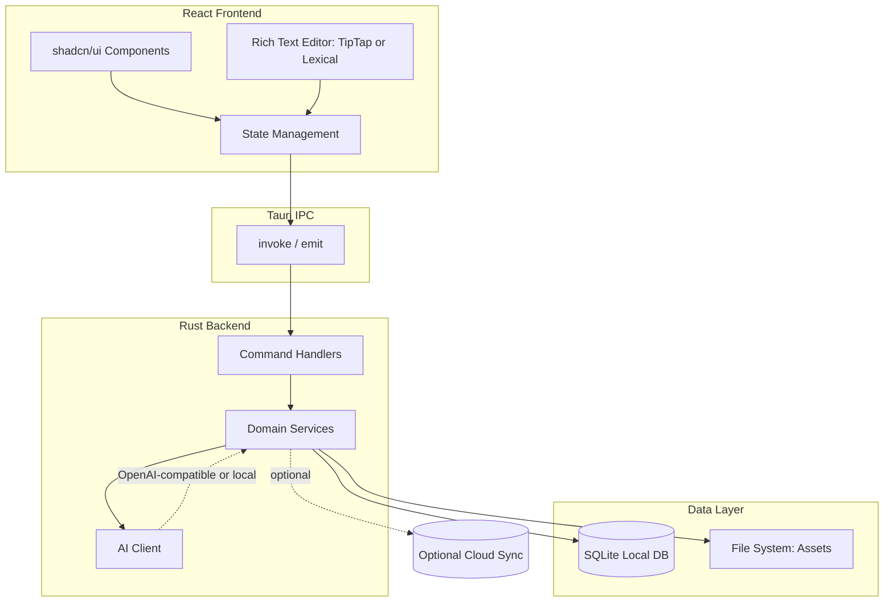
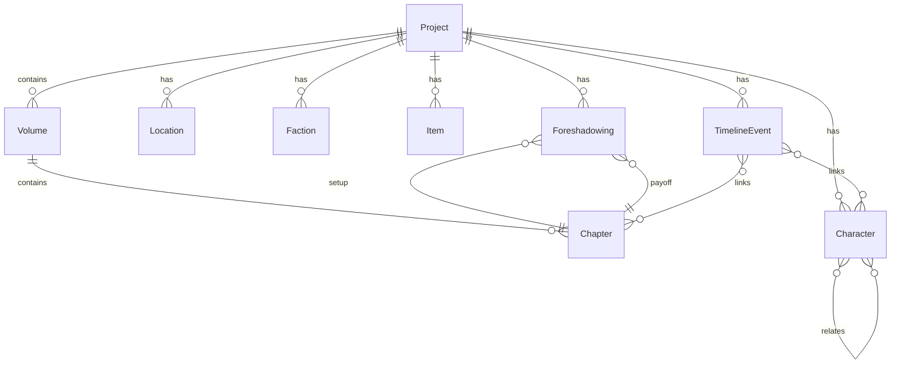

# Thread / 灰线 — 产品概述

> 草蛇灰线，伏脉千里。

---

## 1. 项目简介

**Thread / 灰线** 是一款面向长篇小说作者的 **local-first** 桌面写作工具。名称取自成语「草蛇灰线，伏脉千里」，强调 **foreshadowing / plot-thread tracking（伏笔与线索追踪）** 是本产品的差异化核心：帮助作者在动辄数十万字的长篇中，清晰地埋设、管理与呼应每一条伏笔。

- **定位**：专业长篇小说创作工作台，而非通用文本编辑器。
- **核心理念**：写作 + 设定管理（story bible）+ 伏笔追踪三位一体。
- **技术栈**：Tauri v2 + React + shadcn/ui + TypeScript。

---

## 2. 核心功能

- **章节 / 卷管理 + rich-text editor**：树状组织卷与章节，沉浸式写作、autosave。
- **大纲 / plotline 管理**：多层级大纲，支持并行剧情线。
- **人物设定管理**：人物卡（属性、简介、图片），人物关系图。
- **世界观设定百科（worldbuilding wiki）**：地点、势力、物品等词条，可交叉引用（cross-reference）。
- **时间线 / Timeline**：故事内时间轴，事件与章节/人物关联。
- **伏笔 · 灰线追踪**（核心亮点）：为每条伏笔标记「setup（埋设）→ payoff（呼应）」，可视化未回收伏笔提醒。
- **AI-assisted writing**：续写、润色、灵感生成、基于设定的问答。
- **写作统计**：字数进度、每日/总目标、写作日历与连续打卡（streak）。
- **导出**：TXT / Markdown / EPUB / Word。

---

## 3. 技术架构

- **Frontend**：React + TypeScript + shadcn/ui（基于 Radix UI + Tailwind CSS）。富文本编辑器候选 **TipTap** 或 **Lexical**（见待确认问题）。
- **Backend**：Tauri v2（Rust），负责文件系统访问、本地数据库、系统集成（窗口、菜单、快捷键等）。
- **Storage**：local-first，使用 **SQLite**（经 `tauri-plugin-sql` 或 Rust 侧 `rusqlite`）。云同步（cloud sync）作为可选的后续能力，同步策略与冲突处理（conflict resolution）留作待确认问题。
- **通信**：前端通过 Tauri IPC（`invoke` / `emit`）调用 Rust command。

### 架构图



---

## 4. 数据模型概览

主要实体及关系（字段为示意，实现时细化）：

- **Project（项目）**：一部作品的根容器（标题、简介、创建时间）。
- **Book / Volume（卷）**：隶属 Project，含排序。
- **Chapter（章节）**：隶属 Volume，含正文内容、字数、状态（draft / done）。
- **Character（人物）**：属性、简介、头像；与其他 Character 存在 **relationship**（多对多，带关系类型）。
- **Location（地点）** / **Faction（势力）** / **Item（物品）**：世界观词条，可被章节/事件引用。
- **TimelineEvent（事件）**：故事内时间、描述；关联 Chapter、Character、Location。
- **Foreshadowing（伏笔）**：标题、描述、状态（planted / resolved）；关联 **setup** 与 **payoff**（指向具体 Chapter）。
- **WritingSession / Stats（写作记录）**：日期、写作字数、时长，用于统计与打卡。
- **Tag（标签）**：可附加到多种实体，用于分类检索。



---

## 5. 目录结构规划

建议的仓库结构：

```text
Thread/
├── src/                  # React frontend
│   ├── pages/            # 路由页面
│   ├── layout/           # 壳层布局与 Provider
│   ├── components/       # 业务组件 + ui/
│   ├── stores/           # Zustand 状态
│   ├── i18n/             # 多语言
│   ├── lib/              # 工具与 Tauri IPC 封装
│   └── main.tsx
├── src-tauri/            # Rust backend
│   ├── src/
│   │   ├── commands/     # Tauri command handlers
│   │   ├── services/     # domain services
│   │   └── db/           # SQLite schema & migrations
│   ├── Cargo.toml
│   └── tauri.conf.json
├── docs/                 # documentation
└── README.md
```

---

## 6. 路线图

1. **Phase 1 · MVP**：项目/章节/卷管理 + rich-text editor + 本地 SQLite 存储 + autosave。
2. **Phase 2 · Story bible**：人物、世界观（地点/势力/物品）、Timeline。
3. **Phase 3 · Foreshadowing tracking**：伏笔 setup / payoff 关联、未回收提醒（核心差异化）。
4. **Phase 4 · AI assistance**：续写、润色、设定问答。
5. **Phase 5 · Export & cloud sync**：多格式导出（TXT / MD / EPUB / Word）+ 可选云同步。

---

## 7. 待确认问题

- **Editor framework**：TipTap（基于 ProseMirror，生态丰富）vs Lexical（Meta 出品，性能好）？
- **Cloud sync**：自建同步服务 / 第三方（如 Supabase）/ WebDAV / 网盘？冲突处理策略？
- **AI provider**：本地模型（Ollama 等）vs OpenAI-compatible API？是否需要用户自带 Key（BYOK）？

---

> 本文件为产品概述与技术蓝图，仅描述方向，不含实现代码。
