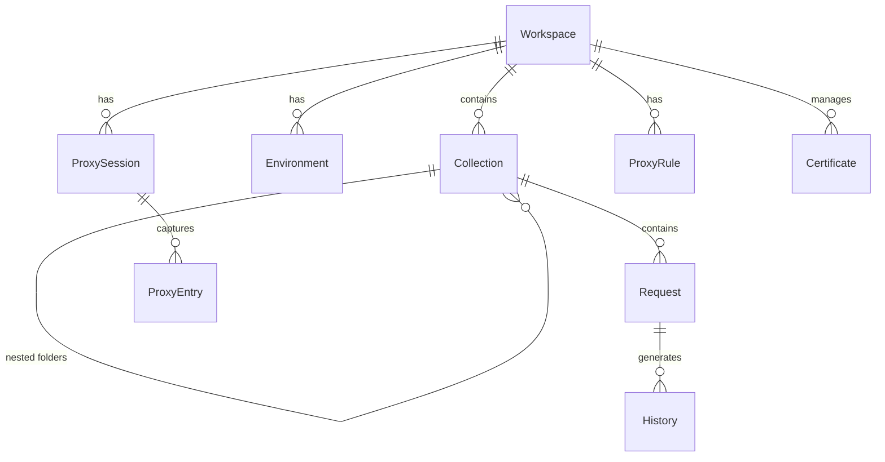

# Thread / 灰线 — 产品概述

> 草蛇灰线，伏脉千里 —— 追踪每一条请求的脉络。

---

## 1. 项目简介

**Thread / 灰线** 是一款面向开发者的 **local-first** 跨平台桌面工具，融合 **API 请求测试**（类 Postman）与 **网络抓包代理**（类 Proxyman）两大核心能力。名称取自成语「草蛇灰线，伏脉千里」，寓意追踪每一条请求的完整脉络——从构造、发送、到响应与诊断。

- **定位**：面向后端与全栈开发者的一站式 API 开发调试工作台。
- **核心理念**：请求测试 + 抓包代理 + 环境管理 三位一体。
- **技术栈**：Tauri v2 + React + shadcn/ui + TypeScript。

---

## 2. 核心功能

### 2.1 请求测试（API Client）

支持多种协议的请求构建、发送与响应检查：

- **HTTP / HTTPS**：GET / POST / PUT / PATCH / DELETE / HEAD / OPTIONS，支持 Query Params、Headers、Body（JSON / Form / Binary / Raw）、Auth（Bearer / Basic / API Key / OAuth 2.0）。
- **gRPC**：加载 `.proto` 文件或使用服务端反射（Server Reflection），Unary / Server-streaming / Client-streaming / Bidirectional-streaming 四种调用模式。
- **WebSocket**：连接管理、消息发送/接收、自动 ping/pong、消息历史记录。
- **GraphQL**：Schema 加载与自动补全、Query / Mutation / Subscription，Variables 与 Headers 编辑。
- **MQTT**：Broker 连接（TCP / WebSocket / TLS）、Topic 订阅与发布、QoS 选择、消息流查看。

### 2.2 抓包代理（Network Proxy）

系统级 HTTP/HTTPS 代理，实时捕获与分析网络流量：

- **HTTPS 解密**：自动生成并安装本地 CA 根证书，MITM 解密 TLS 流量。
- **请求/响应查看**：Headers、Body（自动检测格式并高亮：JSON / XML / HTML / Binary）、Timing 时序。
- **过滤与搜索**：按域名、路径、方法、状态码、Content-Type 等条件过滤；全文搜索。
- **断点与修改**：拦截请求/响应进行实时修改（Breakpoint），支持 Map Local / Map Remote 规则。
- **规则引擎**：Block / Allow 列表，自定义请求/响应改写规则。

### 2.3 集合与环境管理

- **集合（Collection）**：按项目/模块组织请求，支持文件夹嵌套、拖拽排序。
- **环境变量（Environment）**：多环境切换（开发/测试/生产），变量替换 `{{baseUrl}}`，支持全局与集合级变量。
- **前/后置脚本（Pre/Post Script）**：请求发送前后执行脚本，可用于动态签名、Token 刷新、断言校验。

### 2.4 辅助功能

- **请求历史**：自动记录所有发送的请求，可一键重发或保存到集合。
- **Cookie 管理**：按域名管理 Cookie Jar。
- **证书管理**：Client Certificate / CA 证书配置。
- **导入/导出**：兼容 Postman Collection v2.1、OpenAPI 3.x、cURL、HAR。
- **Mock Server**（预留）：本地 Mock 服务，基于规则返回固定/动态响应。

---

## 3. 技术架构

- **Frontend**：React + TypeScript + shadcn/ui（基于 Radix UI + Tailwind CSS）。请求编辑器基于 Monaco Editor（见 §7.1）。
- **Backend**：Tauri v2（Rust），负责网络请求执行、代理服务、TLS 处理、证书管理、本地数据库。
- **Storage**：local-first，使用 SQLite 存储集合、环境、历史记录等数据。
- **通信**：前端通过 Tauri IPC（`invoke` / `emit`）调用 Rust 后端。

### 架构图

```mermaid
flowchart TD
    subgraph Frontend [React Frontend]
        UI[shadcn/ui Components]
        ReqEditor[Request Editor]
        ProxyViewer[Proxy Traffic Viewer]
        State[State Management]
    end

    subgraph Bridge [Tauri IPC]
        IPC["invoke / emit"]
    end

    subgraph Backend [Rust Backend]
        Cmd[Command Handlers]
        HttpClient[HTTP / gRPC / WS / GraphQL / MQTT Client]
        ProxyEngine[Proxy Engine MITM]
        CertMgr[Certificate Manager]
        ScriptRunner[Script Runner]
    end

    subgraph Storage [Data Layer]
        DB[(SQLite)]
        FS[File System: Certs / Proto / Config]
    end

    Network((Network)]

    UI --> State
    ReqEditor --> State
    ProxyViewer --> State
    State --> IPC
    IPC --> Cmd
    Cmd --> HttpClient --> Network
    Cmd --> ProxyEngine --> Network
    Cmd --> CertMgr --> FS
    Cmd --> ScriptRunner
    Cmd --> DB
```

---

## 4. 数据模型概览

主要实体及关系（字段为示意，实现时细化）：

- **Workspace（工作区）**：顶层容器，包含集合、环境、代理配置。
- **Collection（集合）**：请求的组织单元，支持嵌套文件夹。
- **Request（请求）**：隶属集合或文件夹，含协议类型、URL、Headers、Body、Auth、Scripts 等完整配置。
- **Environment（环境）**：变量键值对集合，可切换激活。
- **History（历史记录）**：已发送请求与响应的快照。
- **ProxySession（代理会话）**：一次代理捕获会话中的所有流量记录。
- **ProxyEntry（代理条目）**：单条被捕获的请求/响应对。
- **ProxyRule（代理规则）**：断点、改写、Block/Allow 规则。
- **Certificate（证书）**：CA 根证书、客户端证书。



---

## 5. 目录结构规划

```text
Thread/
├── src/                      # React frontend
│   ├── pages/                # 路由页面
│   ├── layout/               # 壳层布局与 Provider
│   ├── components/           # 业务组件 + ui/
│   ├── stores/               # Zustand 状态
│   ├── i18n/                 # 多语言
│   ├── lib/                  # 工具、IPC 封装、编辑器
│   └── main.tsx
├── src-tauri/                # Rust backend
│   ├── src/
│   │   ├── commands/         # Tauri command handlers
│   │   ├── services/         # 业务服务（client、proxy、cert ...）
│   │   ├── proxy/            # 代理引擎核心
│   │   ├── clients/          # 各协议 client 实现
│   │   └── db/               # SQLite schema & migrations
│   ├── Cargo.toml
│   └── tauri.conf.json
├── docs/                     # 设计文档
└── README.md
```

---

## 6. 路线图

1. **Phase 1 · MVP**：HTTP 请求测试 + 集合管理 + 环境变量 + 请求历史 + SQLite 存储。
2. **Phase 2 · 多协议**：gRPC + WebSocket + GraphQL + MQTT 支持。
3. **Phase 3 · 抓包代理**：HTTP/HTTPS 代理引擎 + MITM + 流量查看与过滤。
4. **Phase 4 · 高级代理**：断点修改 + Map Local/Remote + 规则引擎 + Block/Allow。
5. **Phase 5 · 脚本与自动化**：前/后置脚本 + 断言 + 测试运行器。
6. **Phase 6 · 生态**：导入/导出（Postman / OpenAPI / cURL / HAR）+ Mock Server。

---

## 7. 已确认决策

> 以下问题经调研 Yaak（Tauri + Rust）、Bruno（Electron + Node.js）、Hoppscotch（Vue Web）等同类产品后确定。

### 7.1 代码编辑器 → Monaco Editor

选择 **Monaco Editor**（VS Code 内核），理由：
- 智能补全、多光标、小地图等功能对 API 开发体验加分明显。
- 对桌面应用而言，~2MB gzip 的体积代价完全可接受。
- 使用场景：请求 Body 编辑（JSON / GraphQL）、响应 Body 展示、前/后置脚本编辑。

### 7.2 gRPC → 同时支持 .proto 文件加载 + Server Reflection

与 Yaak、Bruno 做法一致，两种方式均支持：
- **加载 .proto 文件**：用户指定 `.proto` 路径，Rust 侧解析服务/方法列表。
- **Server Reflection**：连接 gRPC 服务端自动发现服务，无需 `.proto` 文件。

### 7.3 代理模式 → HTTP + SOCKS5 均支持

参考 Yaak（`yaak-proxy` / `yaak-proxy-lib`），同时支持 HTTP 代理与 SOCKS5 代理。

### 7.4 请求发送 → Rust 侧执行（非 WebView）

所有网络请求在 **Rust 后端** 发起，前端通过 IPC 调用。原因：
- Tauri WebView 受浏览器同源策略（CORS）限制，`fetch` 无法直连大量目标 API。
- gRPC（HTTP/2 + Protobuf）、MQTT（TCP 长连接）在 WebView 中无法原生实现。
- 代理抓包需要 MITM TLS 终结，只能在 Rust/系统层完成。
- Yaak 等同类 Tauri 应用均采用此方案。
- Bruno 能在 JS 侧发请求，是因为 Electron 主进程拥有完整 Node.js 运行时且无 CORS 限制，与 Tauri WebView 机制根本不同。

### 7.5 数据存储与 Git 同步 → 文件优先 + SQLite 索引

参考 Bruno 的「文件即数据」设计（`.bru` 文件 + 文件夹结构），结合 Yaak 的 `yaak-git` 方案，采用**混合模式**：

- **持久化数据源为文件**：集合/请求/环境以 JSON/YAML 文件存储在用户选择的目录中，一个 Collection 即一个文件夹。
- **SQLite 作为运行时索引/缓存**：应用启动时扫描文件建立索引，提供快速搜索与查询。代理流量、请求历史等临时数据直接存 SQLite。
- **Git 为一等公民**：用户在 Collection 目录上 `git init` 即可获得版本控制与团队协作能力，无需额外同步层。
- 此方案的优势：文件可直接 diff/review、零同步开发成本、用户可用任意 Git 工具。

### 7.6 脚本运行时 → 暂缓（Phase 5）

预选方案：**QuickJS**（Bruno 同款，`quickjs-emscripten`），轻量 JS 引擎、安全沙箱。具体选型在 Phase 5 评估。

---

> 本文件为产品概述与技术蓝图，仅描述方向，不含实现代码。
