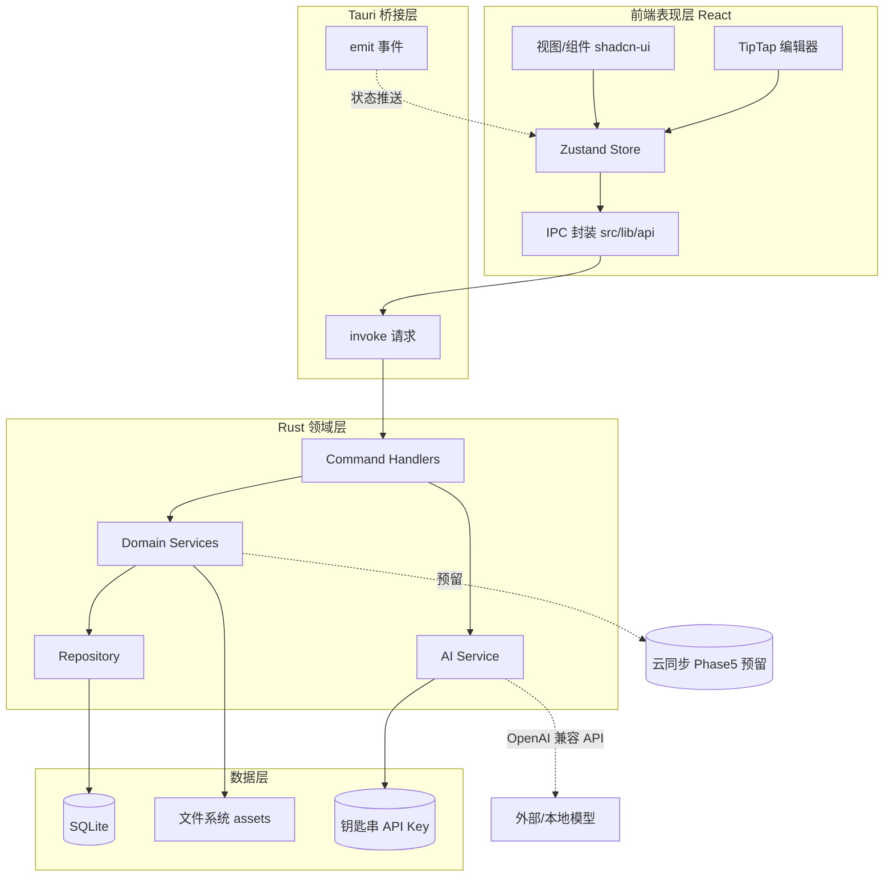
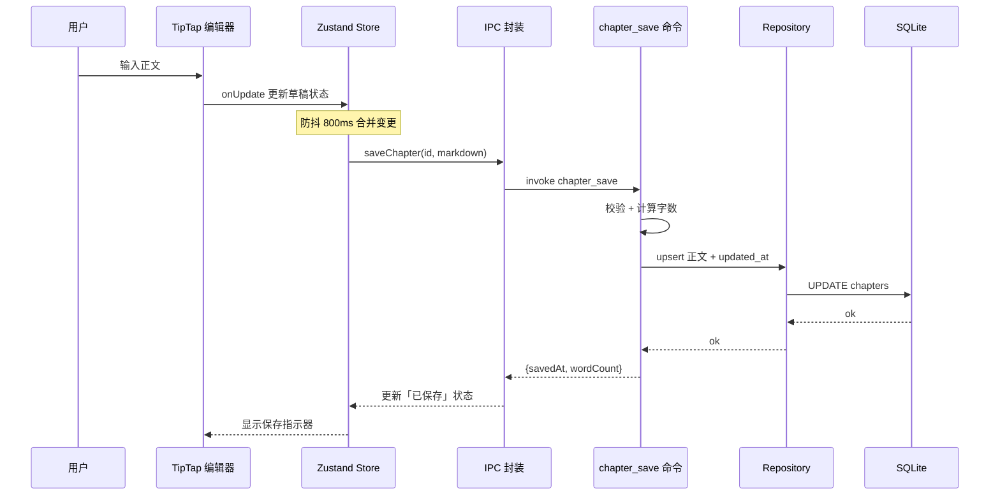
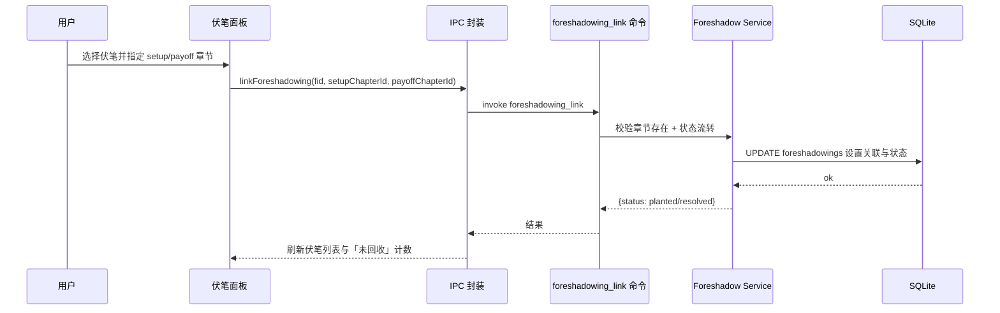
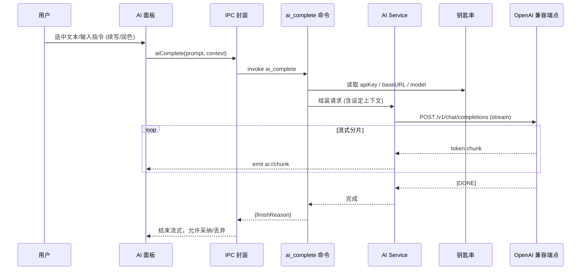

# Thread / 灰线 — 架构设计

> 本文承接 [00.overview.md](00.overview.md) 第 3 节与 [01.tech-stack.md](01.tech-stack.md)，细化分层架构、职责边界与关键数据流。

---

## 1. 分层架构

Thread 采用 **前端表现层 + Tauri 桥接层 + Rust 领域层 + 数据层** 的分层结构。前端不直接触碰数据库文件与 AI Key，所有敏感操作经 Rust 后端。

---

## 2. 职责边界

| 层 | 职责 | 不负责 |
| --- | --- | --- |
| 前端表现层 | 渲染、交互、编辑器状态、本地 UI 状态、乐观更新 | 数据持久化、AI Key、SQL |
| Tauri 桥接层 | `invoke` 调用、`emit` 事件、类型序列化 | 业务逻辑 |
| Rust 领域层 | 业务规则、事务、AI 转发、校验 | UI 逻辑 |
| 数据层 | SQLite 持久化、资源文件、Key 安全存储 | 业务规则 |

**核心原则**：

- 前端通过 `src/lib/api` 的 typed wrapper 调用后端，禁止在组件里散落 `invoke`。
- Rust 侧 command 只做参数校验与编排，具体逻辑落在 service，数据访问落在 repository。
- AI Key、数据库写入等敏感操作只在 Rust 侧发生。

---

## 3. 关键数据流

### 3.1 写作保存流（autosave）

编辑器变更后进入防抖，序列化为 Markdown，经 IPC 落库，成功后回推保存状态。

**要点**：

- 防抖窗口默认 800ms；窗口失焦（`blur`）或切换章节时强制立即保存。
- 保存失败进入重试队列并在 UI 提示，避免丢字。
- 后端每次保存记录 `writing_sessions`（字数增量、时长）供统计模块使用。

### 3.2 伏笔关联流（setup → payoff）

伏笔是差异化核心：埋设点与呼应点均指向具体章节，可视化未回收提醒。

**状态流转**：`planted`（已埋设，仅有 setup）→ `resolved`（已回收，setup 与 payoff 均存在）。未回收伏笔在导航侧栏与统计中高亮提醒。

### 3.3 AI 请求流（BYOK，支持流式）

前端发起 AI 请求，Rust 从钥匙串取 Key，转发至 OpenAI 兼容端点，流式结果经 `emit` 增量回推。

**要点**：

- Key 只在 Rust 侧读取与使用，绝不返回前端。
- 支持流式（`emit` 增量）与非流式两种模式，超时与重试在 AI Service 统一处理。
- 上下文注入：可携带当前章节、相关人物/世界观设定，便于「基于设定的问答」。

---

## 4. 错误处理

- **Rust 侧**：统一 `AppError`（`thiserror`），序列化为 `{ code, message }` 返回前端。
- **前端侧**：`src/lib/api` 捕获并归一化，通过 toast 呈现；可重试错误（保存/AI）进入重试逻辑。
- **错误码约定**：见 [04.ipc-api.md](04.ipc-api.md)。

---

## 5. autosave 与并发约定

- 单窗口单项目，写操作以「最后写入生效」为主；同一章节的保存请求按序列化排队，避免竞态。
- 长耗时任务（AI、导出）异步执行并通过事件反馈进度，不阻塞 UI。
- 为将来云同步预留：所有实体 `updated_at`（毫秒时间戳）+ 软删除（`deleted_at`）。
