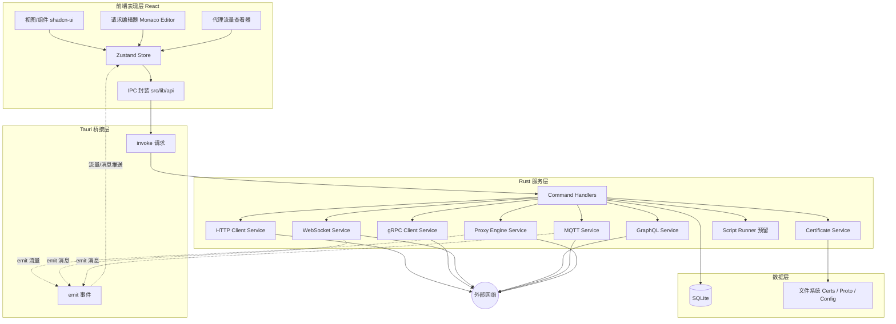
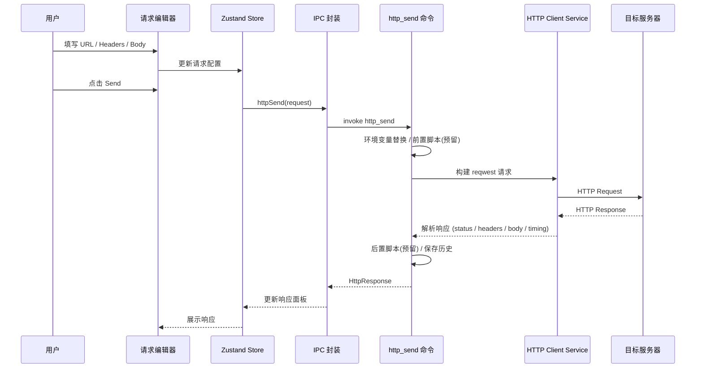
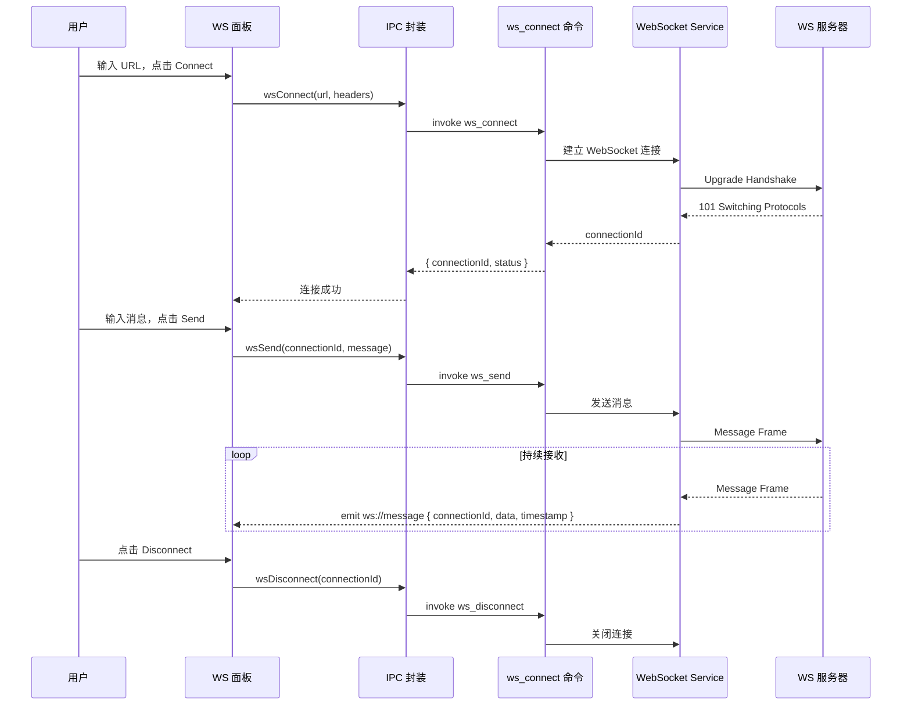
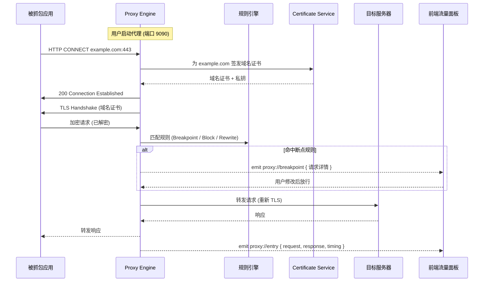
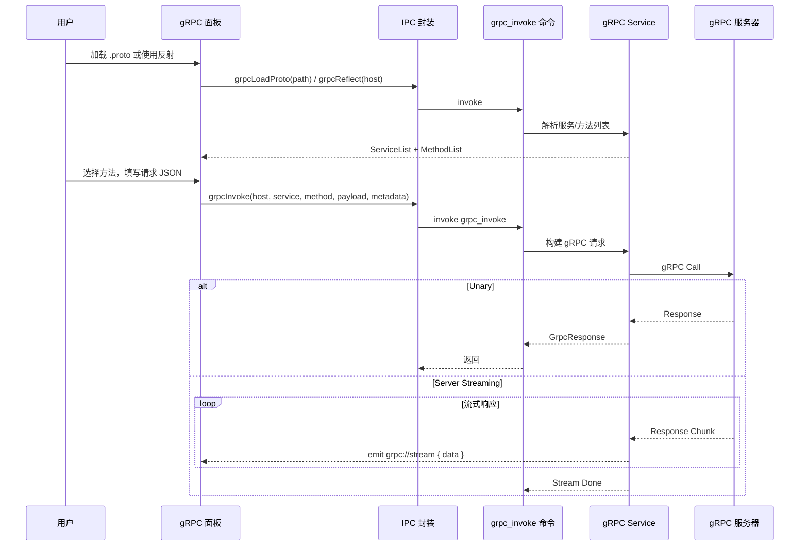
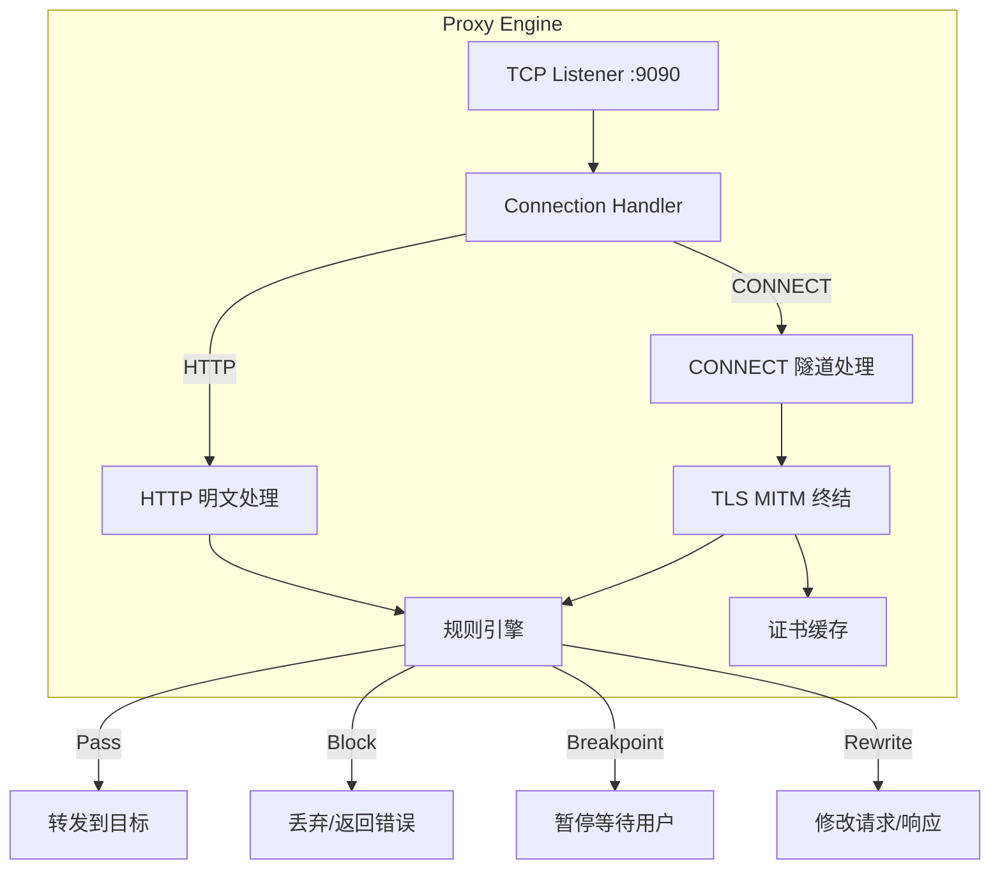

# Thread / 灰线 — 架构设计

> 本文承接 [00.overview.md](00.overview.md) 第 3 节与 [01.tech-stack.md](01.tech-stack.md)，细化分层架构、职责边界与关键数据流。

---

## 1. 分层架构

Thread 采用 **前端表现层 + Tauri 桥接层 + Rust 服务层 + 数据层** 的分层结构。前端不直接执行网络请求和代理操作，所有网络 I/O 均经 Rust 后端处理。

---

## 2. 职责边界

| 层 | 职责 | 不负责 |
| --- | --- | --- |
| 前端表现层 | 渲染 UI、请求编辑器、代理流量展示、本地 UI 状态 | 网络 I/O、TLS 处理、证书操作 |
| Tauri 桥接层 | `invoke` 调用、`emit` 事件推送、类型序列化 | 业务逻辑 |
| Rust 服务层 | 请求执行、代理引擎、协议处理、证书管理、脚本运行 | UI 逻辑 |
| 数据层 | SQLite 持久化、文件（证书/Proto/配置） | 业务规则 |

**核心原则**：

- 前端通过 `src/lib/api` 的 typed wrapper 调用后端，禁止在组件里散落 `invoke`。
- Rust 侧 command 只做参数校验与编排，具体网络操作落在各协议 service。
- 所有网络请求均在 Rust 侧发起，保证 TLS 证书操作、代理拦截等能力可控。
- 长连接（WebSocket / MQTT / gRPC streaming）通过 Tauri emit 事件向前端推送数据。

---

## 3. 关键数据流

### 3.1 HTTP 请求流

用户在请求编辑器中配置请求参数，发送后 Rust 执行请求并返回完整响应。

**要点**：

- 环境变量在发送前由 Rust 侧替换（`{{variable}}` → 实际值）。
- Timing 信息包含 DNS / TCP / TLS / TTFB / Total 各阶段耗时。
- 每次请求自动记录到 History，可配置是否保存 Body。
- 支持取消正在进行的请求。

### 3.2 WebSocket 会话流

WebSocket 为长连接，连接建立后通过 emit 事件实时推送收发消息。

### 3.3 代理抓包流

代理引擎在后台启动，拦截系统/浏览器流量，通过 emit 实时推送到前端。

**要点**：

- 代理引擎独立于主线程运行，通过 channel 与 command 层通信。
- CA 根证书在首次启动时生成，需引导用户安装并信任。
- 默认仅抓包查看，断点/修改为高级功能（Phase 4）。
- 流量数据可选保存到 SQLite 或仅内存保留，避免大量数据撑爆磁盘。

### 3.4 gRPC 调用流

---

## 4. 代理引擎架构

代理引擎是 Thread 的核心组件之一，需要独立设计。

**关键设计**：

- **证书缓存**：为每个域名动态生成的证书缓存在内存中（LRU），避免重复生成。
- **规则引擎**：支持域名匹配（通配符、正则）、路径匹配、方法匹配，规则按优先级排序。
- **并发模型**：每个连接一个 tokio task，使用 channel 向前端推送事件。
- **性能**：大流量下前端采用虚拟列表渲染，后端限制推送频率（批量发送 + 节流）。

---

## 5. 错误处理

- **Rust 侧**：统一 `AppError`（`thiserror`），序列化为 `{ code, message }` 返回前端。
- **前端侧**：`src/lib/api` 捕获并归一化，通过 toast 呈现；网络错误（超时/连接拒绝等）在响应面板内展示。
- **错误码约定**：见 [04.ipc-api.md](04.ipc-api.md)。

---

## 6. 并发与资源管理

- 多个请求可并发发送，每个请求在独立 tokio task 中执行。
- WebSocket / MQTT 长连接通过连接 ID 管理，支持多个同时活跃的连接。
- 代理引擎在后台持续运行，通过 `proxy_start` / `proxy_stop` 控制生命周期。
- 大型响应体（> 10MB）不全量加载到内存，采用分段读取。
- 为将来扩展预留：所有实体带 `updated_at`，UUID 主键。
