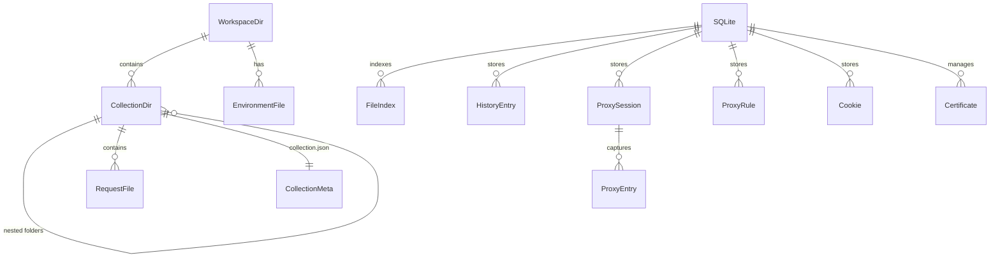

# Thread / 灰线 — 数据存储设计

> 本文承接 [00.overview.md](00.overview.md) 第 7 节已确认决策与 [01.tech-stack.md](01.tech-stack.md) §2.2，定义「文件优先 + SQLite 索引」的混合存储方案。

---

## 1. 存储分层

Thread 采用**双层存储**架构：

| 层 | 介质 | 存储内容 | 特点 |
| --- | --- | --- | --- |
| **持久层** | 文件系统（JSON） | 集合、请求、环境变量、工作区配置 | Git 友好，用户可直接编辑/review |
| **索引/缓存层** | SQLite | 文件索引、请求历史、代理流量、Cookie | 快速查询，丢失可重建 |

**核心原则**：

- 文件是真相（source of truth），SQLite 是派生数据。
- SQLite 数据库丢失后，应用可通过扫描文件目录完整重建索引。
- 代理流量、请求历史等临时/大量数据只存 SQLite，不污染文件目录。

---

## 2. 文件存储格式

### 2.1 工作区目录结构

```text
my-workspace/
├── thread.workspace.json               # 工作区配置
├── environments/
│   ├── global.env.json                  # 全局环境变量
│   ├── dev.env.json                     # 开发环境
│   └── prod.env.json                    # 生产环境
├── my-api/                              # Collection 文件夹
│   ├── collection.json                  # 集合元信息
│   ├── auth/                            # 子文件夹
│   │   ├── login.http.json              # HTTP 请求
│   │   └── refresh-token.http.json
│   ├── users/
│   │   ├── list-users.http.json
│   │   └── create-user.http.json
│   ├── grpc/
│   │   └── hello.grpc.json              # gRPC 请求
│   └── realtime/
│       ├── chat.ws.json                 # WebSocket 请求
│       └── events.mqtt.json             # MQTT 请求
└── another-api/
    └── ...
```

### 2.2 工作区配置 — `thread.workspace.json`

```json
{
  "version": 1,
  "name": "My Workspace",
  "activeEnvironment": "dev",
  "proxy": {
    "port": 9090,
    "autoStart": false
  },
  "settings": {
    "timeoutMs": 30000,
    "followRedirects": true,
    "verifySsl": true
  }
}
```

### 2.3 环境变量 — `*.env.json`

```json
{
  "version": 1,
  "name": "dev",
  "variables": [
    { "key": "baseUrl", "value": "http://localhost:3000", "enabled": true, "secret": false },
    { "key": "apiKey", "value": "sk-dev-xxx", "enabled": true, "secret": true },
    { "key": "timeout", "value": "5000", "enabled": false, "secret": false }
  ]
}
```

> `secret: true` 的变量在 UI 中遮罩显示。是否加密存储待 Phase 5 脚本运行时一起评估。

### 2.4 集合元信息 — `collection.json`

```json
{
  "version": 1,
  "name": "My API",
  "description": "Backend API collection",
  "auth": {
    "type": "bearer",
    "token": "{{apiKey}}"
  },
  "headers": [
    { "key": "Content-Type", "value": "application/json", "enabled": true }
  ],
  "preScript": "",
  "postScript": ""
}
```

> 集合级的 auth / headers / scripts 会被子请求继承，请求级配置优先。

### 2.5 HTTP 请求 — `*.http.json`

```json
{
  "version": 1,
  "protocol": "http",
  "name": "Create User",
  "method": "POST",
  "url": "{{baseUrl}}/api/users",
  "queryParams": [
    { "key": "page", "value": "1", "enabled": false, "description": "" }
  ],
  "headers": [
    { "key": "Authorization", "value": "Bearer {{apiKey}}", "enabled": true }
  ],
  "body": {
    "type": "json",
    "content": "{\n  \"name\": \"John\",\n  \"email\": \"john@example.com\"\n}"
  },
  "auth": { "type": "inherit" },
  "settings": {
    "timeoutMs": 10000,
    "followRedirects": true,
    "verifySsl": true
  },
  "preScript": "",
  "postScript": ""
}
```

### 2.6 gRPC 请求 — `*.grpc.json`

```json
{
  "version": 1,
  "protocol": "grpc",
  "name": "SayHello",
  "host": "localhost:50051",
  "service": "helloworld.Greeter",
  "method": "SayHello",
  "protoSource": "file",
  "protoFilePath": "./protos/helloworld.proto",
  "metadata": [
    { "key": "authorization", "value": "Bearer {{apiKey}}" }
  ],
  "payload": "{\n  \"name\": \"World\"\n}",
  "tlsEnabled": false,
  "timeoutMs": 30000
}
```

### 2.7 WebSocket 请求 — `*.ws.json`

```json
{
  "version": 1,
  "protocol": "websocket",
  "name": "Chat Socket",
  "url": "wss://{{baseUrl}}/ws/chat",
  "headers": [],
  "protocols": [],
  "autoReconnect": false,
  "savedMessages": [
    { "name": "ping", "content": "{\"type\":\"ping\"}", "isBinary": false }
  ]
}
```

### 2.8 GraphQL 请求 — `*.graphql.json`

```json
{
  "version": 1,
  "protocol": "graphql",
  "name": "Get Users",
  "endpoint": "{{baseUrl}}/graphql",
  "query": "query GetUsers($limit: Int!) {\n  users(limit: $limit) {\n    id\n    name\n  }\n}",
  "variables": "{\n  \"limit\": 10\n}",
  "headers": [],
  "auth": { "type": "inherit" }
}
```

### 2.9 MQTT 请求 — `*.mqtt.json`

```json
{
  "version": 1,
  "protocol": "mqtt",
  "name": "IoT Events",
  "brokerUrl": "mqtt://{{mqttHost}}:1883",
  "clientId": "thread-client-001",
  "username": "",
  "password": "",
  "subscriptions": [
    { "topic": "devices/+/telemetry", "qos": 1 }
  ],
  "publishDefaults": {
    "topic": "devices/cmd",
    "qos": 0,
    "retain": false
  },
  "tlsEnabled": false,
  "keepAliveSecs": 60
}
```

### 2.10 稳定 ID、文件名与写入约定

阶段 0 落地了以下约定（实现见 `src-tauri/src/workspace/layout.rs` 与 `files.rs`，验证数据见 [08.refactor-baseline.md](08.refactor-baseline.md)）：

- **稳定 ID**：集合/请求/环境/工作区文件均可带 `id`（UUID v4，创建时写入）。**缺失 `id` 的文件不会被扫描改写**，其稳定标识为 `path:<工作区相对路径>`；应用保存该对象时才补写真实 UUID。
- **文件名**：显示名经 `slugify` 转文件名（保留中英文，空格与 `<>:"/\|?*` 折叠为 `-`，截断 60 字符）；同名冲突追加 `-2`、`-3`。
- **原子写入**：所有写入走「同目录临时文件 + fsync + rename」；JSON 统一 2 空格缩进 + 末尾换行，便于 diff。
- **版本号**：每个文件带 `version`（当前 1）；读取容错缺省字段，写入时补齐 `version`/`id`。
- **`activeEnvironment` 取值**：按「环境 `id` → 环境 `name` → 文件主干名（如 `dev`）」依次匹配，兼容手写文件。
- **机密变量**：`secret: true` 的变量在文件中保持 `"value": ""`，真实值存放于 `<数据目录>/thread/secrets/<workspace-key>.json`，不进入 Git（详见 [08.refactor-baseline.md](08.refactor-baseline.md) §2.5）。
- **删除**：集合/请求/环境删除时移入 `<数据目录>/thread/trash/<时间戳>/`，不直接 unlink。

---

## 3. SQLite 索引/缓存层

SQLite 数据库文件位于应用数据目录（`$APPDATA/thread/thread.db`），仅存储**派生索引**与**临时数据**。

### 3.1 通用约定

- **主键**：`TEXT` 存储 UUID v4。
- **时间戳**：`created_at` 使用毫秒 Unix 时间戳（`INTEGER`）。
- 索引数据可随时通过扫描文件目录重建。

> **阶段 0 实测结论：暂不引入 `file_index` 表。** 全量扫描 1200 个请求文件耗时 53 ms（约 0.04 ms/文件），内存索引搜索约 0.17 ms/次，远低于需要索引层的规模。该表保留为设计草案，当工作区请求文件 > 5 万个、单次扫描 > 1 s 或需要跨工作区全文检索时再评估（数据与复核条件见 [08.refactor-baseline.md](08.refactor-baseline.md) §4）。

### 3.2 文件索引表（暂缓，见上方说明）

```sql
-- 文件索引：应用启动时扫描工作区文件填充
CREATE TABLE file_index (
    id              TEXT PRIMARY KEY,
    workspace_path  TEXT NOT NULL,              -- 工作区根目录
    file_path       TEXT NOT NULL UNIQUE,       -- 相对于工作区的文件路径
    file_type       TEXT NOT NULL,              -- workspace | collection | environment | request
    protocol        TEXT,                       -- http | grpc | websocket | graphql | mqtt (仅 request)
    name            TEXT NOT NULL,              -- 解析自文件内容
    parent_path     TEXT,                       -- 所属集合/文件夹路径
    content_hash    TEXT,                       -- 文件内容 hash，用于检测变更
    indexed_at      INTEGER NOT NULL            -- 索引时间
);

CREATE INDEX idx_file_index_workspace ON file_index(workspace_path);
CREATE INDEX idx_file_index_type      ON file_index(file_type);
CREATE INDEX idx_file_index_parent    ON file_index(parent_path);
CREATE INDEX idx_file_index_protocol  ON file_index(protocol);
```

### 3.3 请求历史

```sql
-- 历史记录：已发送请求与响应的快照
CREATE TABLE history_entries (
    id                TEXT PRIMARY KEY,
    workspace_path    TEXT NOT NULL,
    request_file_path TEXT,                     -- 关联的请求文件（临时请求为 null）
    protocol          TEXT NOT NULL,
    name              TEXT,
    url               TEXT,
    method            TEXT,
    request_snapshot  TEXT NOT NULL,            -- JSON: 请求完整快照
    response_snapshot TEXT,                     -- JSON: 响应快照（headers/status/timing）
    response_body_path TEXT,                   -- 大响应体文件路径
    status_code       INTEGER,
    duration_ms       INTEGER,
    created_at        INTEGER NOT NULL
);

CREATE INDEX idx_history_workspace ON history_entries(workspace_path);
CREATE INDEX idx_history_created   ON history_entries(created_at DESC);
CREATE INDEX idx_history_protocol  ON history_entries(protocol);
```

### 3.4 代理流量

```sql
-- 代理会话
CREATE TABLE proxy_sessions (
    id              TEXT PRIMARY KEY,
    workspace_path  TEXT NOT NULL,
    port            INTEGER NOT NULL DEFAULT 9090,
    started_at      INTEGER NOT NULL,
    stopped_at      INTEGER
);

-- 代理捕获条目（高频写入，定期清理）
CREATE TABLE proxy_entries (
    id                TEXT PRIMARY KEY,
    session_id        TEXT NOT NULL REFERENCES proxy_sessions(id) ON DELETE CASCADE,
    method            TEXT,
    url               TEXT NOT NULL,
    host              TEXT NOT NULL,
    path              TEXT,
    status_code       INTEGER,
    request_headers   TEXT,                    -- JSON
    request_body_size INTEGER DEFAULT 0,
    response_headers  TEXT,                    -- JSON
    response_body_size INTEGER DEFAULT 0,
    content_type      TEXT,
    timing            TEXT,                    -- JSON: { dns, tcp, tls, ttfb, total }
    matched_rule_id   TEXT,
    captured_at       INTEGER NOT NULL
);

CREATE INDEX idx_proxy_entries_session  ON proxy_entries(session_id);
CREATE INDEX idx_proxy_entries_host     ON proxy_entries(host);
CREATE INDEX idx_proxy_entries_captured ON proxy_entries(captured_at DESC);
```

### 3.5 代理规则

```sql
-- 代理规则（也可存文件，但查询频繁故存 SQLite）
CREATE TABLE proxy_rules (
    id              TEXT PRIMARY KEY,
    workspace_path  TEXT NOT NULL,
    name            TEXT NOT NULL,
    enabled         INTEGER NOT NULL DEFAULT 1,
    rule_type       TEXT NOT NULL,             -- block | allow | breakpoint | map_local | map_remote | rewrite
    match_pattern   TEXT NOT NULL,
    match_scope     TEXT DEFAULT 'url',        -- url | host | path
    action_config   TEXT,                      -- JSON
    priority        INTEGER NOT NULL DEFAULT 0,
    created_at      INTEGER NOT NULL,
    updated_at      INTEGER NOT NULL
);

CREATE INDEX idx_proxy_rules_workspace ON proxy_rules(workspace_path);
```

### 3.6 Cookie Jar

```sql
CREATE TABLE cookies (
    id              TEXT PRIMARY KEY,
    workspace_path  TEXT NOT NULL,
    domain          TEXT NOT NULL,
    path            TEXT NOT NULL DEFAULT '/',
    name            TEXT NOT NULL,
    value           TEXT NOT NULL,
    secure          INTEGER DEFAULT 0,
    http_only       INTEGER DEFAULT 0,
    same_site       TEXT,
    expires_at      INTEGER,
    created_at      INTEGER NOT NULL,
    updated_at      INTEGER NOT NULL,
    UNIQUE (workspace_path, domain, path, name)
);

CREATE INDEX idx_cookies_workspace ON cookies(workspace_path);
CREATE INDEX idx_cookies_domain    ON cookies(domain);
```

### 3.7 证书

```sql
CREATE TABLE certificates (
    id              TEXT PRIMARY KEY,
    workspace_path  TEXT NOT NULL,
    name            TEXT NOT NULL,
    cert_type       TEXT NOT NULL,             -- ca_root | client
    cert_pem        TEXT,
    key_pem         TEXT,
    cert_file_path  TEXT,
    key_file_path   TEXT,
    is_system_ca    INTEGER DEFAULT 0,
    host_pattern    TEXT,
    created_at      INTEGER NOT NULL,
    updated_at      INTEGER NOT NULL
);

CREATE INDEX idx_certificates_workspace ON certificates(workspace_path);
```

---

## 4. 迁移方案

### 4.1 文件版本

每个 JSON 文件包含 `version` 字段。当文件格式变更时：
- 新增 version 号。
- 应用读取旧版本文件时自动迁移到新格式（in-place 升级或提示用户）。
- 向后兼容：新版本应用可读旧文件，旧版本应用对新文件给出明确错误提示。

### 4.2 SQLite 迁移

使用 `PRAGMA user_version` 管理版本：

```rust
// src-tauri/src/db/migrations.rs（示意）
pub struct Migration {
    pub version: u32,
    pub description: &'static str,
    pub sql: &'static str,
}

pub fn migrations() -> Vec<Migration> {
    vec![
        Migration {
            version: 1,
            description: "init schema",
            sql: include_str!("../../migrations/0001_init.sql"),
        },
    ]
}
```

- SQL 文件按 `migrations/000N_*.sql` 顺序编号，只增不改。
- SQLite 索引数据可随时重建，迁移失败时可 fallback 到删库重建索引。

---

## 5. 文件监控与索引同步

- 应用启动时全量扫描工作区目录，构建 `file_index` 表。
- 运行时使用文件系统监听（`notify` crate）监控变更，增量更新索引。
- 外部编辑（用户直接改文件、Git pull）触发索引刷新，前端通过事件通知更新 UI。
- `content_hash` 字段用于快速判断文件是否变更，避免不必要的重新解析。

---

## 6. ER 图



---

## 7. 数据清理策略

- **历史记录**：支持按时间/数量限制自动清理（如保留最近 30 天或 10000 条）。
- **代理条目**：会话结束后可选自动清理，或手动清理。
- **响应体文件**：大响应体保存在 `$APPDATA/thread/bodies/{uuid}`，随历史记录删除时同步清理。
- **索引重建**：提供「重建索引」功能，删除 SQLite 后重新扫描文件目录。
