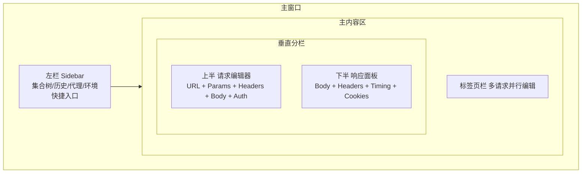
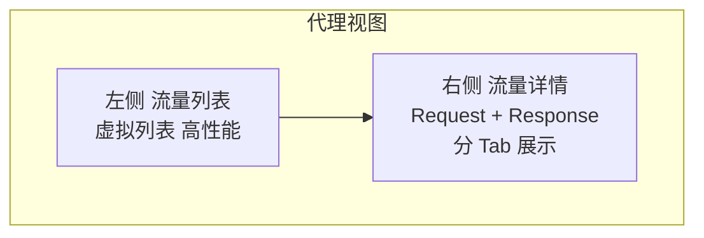
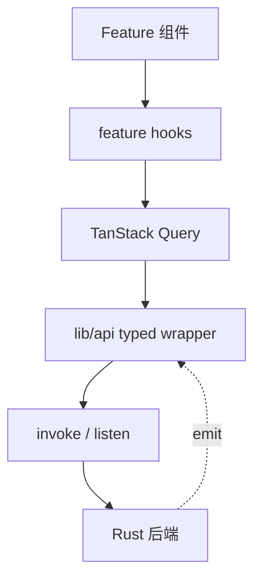

# Thread / 灰线 — 前端模块设计

> 本文承接 [01.tech-stack.md](01.tech-stack.md) 与 [04.ipc-api.md](04.ipc-api.md)，定义前端目录结构、界面布局、路由、状态管理与编辑器集成要点。

---

## 1. 目录结构

```text
src/
├── main.tsx                     # 入口
├── App.tsx                      # Provider + RouterProvider
├── app/
│   └── router.tsx               # TanStack Router 路由树
├── pages/                       # 路由页面
│   ├── home-page.tsx            # 欢迎/快速操作
│   ├── request-page.tsx         # 请求编辑与响应（主工作区）
│   ├── collection-page.tsx      # 集合管理
│   ├── environment-page.tsx     # 环境变量管理
│   ├── history-page.tsx         # 请求历史（请求/响应双端对照）
│   ├── proxy-page.tsx           # 代理流量查看
│   ├── proxy-rules-page.tsx     # 代理规则管理
│   ├── certificate-page.tsx     # 证书管理
│   └── settings-page.tsx        # 全局设置
├── layout/
│   ├── app-layout.tsx           # 顶层壳（标题栏 + Sidebar + 内容区）
│   └── providers/
│       └── app-providers.tsx    # ThemeProvider + QueryClient + Router
├── components/
│   ├── request/                 # 请求编辑相关组件
│   │   ├── request-editor.tsx       # 请求配置主体
│   │   ├── request-url-bar.tsx      # URL + Method 选择 + Send 按钮
│   │   ├── request-params.tsx       # Query Params 编辑器
│   │   ├── request-headers.tsx      # Headers 编辑器
│   │   ├── request-body.tsx         # Body 编辑器（JSON/Form/Raw/Binary）
│   │   ├── request-auth.tsx         # 认证配置
│   │   └── request-scripts.tsx      # 前/后置脚本（预留）
│   ├── response/                # 响应展示相关组件
│   │   ├── response-panel.tsx       # 响应主面板
│   │   ├── response-body.tsx        # Body 展示（带语法高亮）
│   │   ├── response-headers.tsx     # Headers 表格
│   │   └── response-timing.tsx      # Timing 时序图
│   ├── grpc/                    # gRPC 相关组件
│   │   ├── grpc-panel.tsx
│   │   └── grpc-service-tree.tsx
│   ├── websocket/               # WebSocket 相关组件
│   │   └── ws-panel.tsx
│   ├── graphql/                 # GraphQL 相关组件
│   │   └── graphql-panel.tsx
│   ├── mqtt/                    # MQTT 相关组件
│   │   └── mqtt-panel.tsx
│   ├── proxy/                   # 代理相关组件
│   │   ├── proxy-traffic-list.tsx   # 流量列表（虚拟列表）
│   │   ├── proxy-entry-detail.tsx   # 单条流量详情
│   │   └── proxy-controls.tsx       # 代理启动/停止/过滤栏
│   ├── environment/             # 环境变量组件
│   │   └── env-editor.tsx
│   ├── collection-tree.tsx      # 左栏集合导航树
│   ├── window-title-bar.tsx     # 自定义标题栏
│   ├── app-error-boundary.tsx
│   └── ui/                      # shadcn/ui 基础组件
├── stores/                      # Zustand store
│   ├── ui-store.ts
│   ├── request-store.ts
│   ├── proxy-store.ts
│   ├── ws-store.ts
│   └── mqtt-store.ts
├── i18n/                        # 多语言
├── lib/
│   ├── api/                     # IPC typed wrapper（见 04.ipc-api.md）
│   ├── editor/                  # Monaco Editor 编辑器封装
│   ├── platform.ts
│   └── utils.ts
└── styles/
```

**约定**：页面进 `pages/`，路由壳进 `layout/`，按功能域分组业务组件进 `components/{domain}/`，基础组件进 `components/ui/`。

---

## 2. 界面布局

主界面采用经典 API 工具的 **侧栏 + 标签页 + 分栏** 布局。



### 2.1 左栏（Sidebar）

- **集合树**：Collections 层级导航，支持搜索、拖拽排序、右键菜单（新建/重命名/删除/复制）。
- **快捷入口**：
  - 历史记录（History）——每次发送的**请求内容 + 响应内容**对照查看 / 重发
  - 环境变量（Environments）
  - 代理（Proxy）
  - 证书（Certificates）
  - 设置（Settings）
- Sidebar 可折叠/展开。

### 2.1.1 标题栏（Title Bar）

- 左侧：应用标识 + 软件名 `Thread` + **工作区切换** + **环境切换**（`components/workspace/switchers.tsx`），
  即工作区/环境的入口常驻标题栏左侧、紧邻软件名；工作区下拉含最近打开列表，环境下拉含「未激活」。
- 右侧：关闭工作区等窗口级操作。
- 标题栏子区域默认禁用指针事件用于窗口拖拽，交互控件需显式加 `pointer-events-auto` 与 `data-no-drag`。

### 2.2 标签页栏

- 每个打开的请求占一个标签页，支持多请求并行编辑。
- 标签页显示请求名 + 协议图标 + 未保存标记。
- 支持拖拽排序、关闭、关闭其他。

### 2.3 请求编辑器（上半）

- **URL Bar**：HTTP 方法下拉 + URL 输入框 + Send 按钮。
- **URL 变量补全**（`components/request/variable-input.tsx`）：
  - 输入 `{{` 后弹出当前工作区可用变量（激活环境 → 全局 → 其他环境 → 内置 `$uuid` 等），
    ↑/↓ 移动高亮、Enter/Tab 或鼠标点击插入 `{{key}}`，Esc 关闭，机密变量带锁标记并显示来源环境；
    已输入的前缀会在候选 key 内加粗高亮，便于确认匹配位置。
  - 输入框右侧常驻「插入变量」按钮：在任意光标位置插入 `{{key}}`，用于发现可用变量 key，无需先手写 `{{`。
  - 按键处理只在列表打开时拦截 ↑/↓/Enter/Tab/Esc，其余情况（如 URL 框 Enter 发送）原样透传。
  - 输入框正文里**已闭合**的 `{{key}}` 会在文字下层画出高亮块（`<input>` 无法局部着色）：
    按输入框的计算样式（字体/内边距/边框）+ canvas 量宽定位，并跟随横向滚动；文字、光标、选区与输入法
    仍由原生 input 处理，不做透明文字处理。
- **Tab 切换**：Params / Headers / Body / Auth / Pre-Script / Post-Script。
- 不同协议显示不同的编辑器布局：
  - HTTP：标准 URL + 方法 + Body
  - gRPC：Host + Service/Method 选择 + Payload JSON
  - WebSocket：URL + Connect/Disconnect + 消息发送框
  - GraphQL：Endpoint + Query 编辑器 + Variables
  - MQTT：Broker URL + Topic + Publish/Subscribe

### 2.4 响应面板（下半）

- **Tab 切换**：Body / Headers / Cookies / Timing / Raw。
- Body 展示：自动检测 Content-Type，Monaco Editor readonly 展示（JSON / XML / HTML）。
- Timing：DNS → TCP → TLS → TTFB → Download 的时序条形图。
- 状态栏：状态码 + 耗时 + Body 大小。

### 2.5 历史页（请求/响应双端对照）

`/history` 全屏页（或侧栏抽屉）展示发送历史，强调**可还原当时发出的请求**，而非仅浏览响应：

- **列表**：时间、方法、URL、状态码、耗时；支持按协议/状态过滤与关键词搜索（命中 URL 或请求/响应 Body 摘要）。
- **详情分栏**：左侧 **Request**（替换后的 URL / Headers / Body / Auth），右侧 **Response**（Status / Headers / Body / Timing）；布局与主工作区请求-响应对照一致。
- **操作**：重发（`history_replay`）、另存到集合（用请求快照）、复制为 cURL、删除单条 / 按条件清理。
- **设置入口**：是否保存 Body、脱敏、保留天数——链到 Settings。

### 2.6 代理视图

代理模式下切换为独立视图：



- 顶部工具栏：Start/Stop 按钮 + 过滤条件（域名/路径/方法/状态码/Content-Type）+ 搜索框 + Clear 按钮。
- 流量列表采用虚拟列表（`@tanstack/react-virtual` 或 `react-window`），支持数万条记录流畅滚动。

### 2.7 下拉选择控件约定

- **不使用原生 `<select>`**：原生弹层由操作系统绘制（macOS/Windows/Linux 观感、行高、圆角、勾选样式各不相同），
  与设计令牌脱节；应用内所有下拉统一走 `@/components/ui/select.tsx`（shadcn base-ui `Select`，自绘弹层，支持键盘与 ARIA）。
- 枚举型下拉（HTTP 方法、请求体类型、认证方式、请求设置等）统一使用薄封装
  `@/components/ui/select-field.tsx`：`value` + `options` + `onValueChange`，触发按钮宽度/配色由 `className` 覆盖。
- 需要搜索、多选或分组时，直接用 `select.tsx` 的组合式 API 组合 `SelectItem`。

---

## 3. 路由结构

使用 **TanStack Router**，单窗口内多视图：

```text
/                                   # Home / 快速操作
/request/$requestId                 # 请求编辑与响应
/collection                         # 集合管理
/environment                        # 环境变量管理
/history                            # 请求历史
/proxy                              # 代理流量查看
/proxy/rules                        # 代理规则管理
/certificate                        # 证书管理
/settings                           # 全局设置
```

实际使用中，请求编辑常以标签页形式呈现在主内容区，路由更多用于 Sidebar 导航的全屏页面。

---

## 4. 状态管理（Zustand）

按关注点拆分多个小 store：

| Store | 职责 |
| --- | --- |
| `useUiStore` | 布局状态（Sidebar 折叠、活跃标签页、分栏比例、主题） |
| `useRequestStore` | 当前编辑的请求配置、打开的标签页列表、脏标记 |
| `useProxyStore` | 代理引擎状态（running/stopped）、过滤条件、捕获的流量（内存） |
| `useWsStore` | WebSocket 活跃连接、消息历史 |
| `useMqttStore` | MQTT 活跃连接、订阅 Topic、消息流 |

- **服务端数据**（集合列表/历史/环境变量）优先用 **TanStack Query** 缓存，Zustand 只存**纯 UI/交互状态**与实时流数据。
- 写操作成功后失效相关 query key（如 `["collections", workspaceId]`）。
- 代理流量与 WebSocket/MQTT 消息为高频实时数据，直接存 Zustand，不经 Query。

```ts
// stores/proxy-store.ts（示意）
import { create } from "zustand";

interface ProxyEntry {
  id: string;
  method: string;
  url: string;
  statusCode?: number;
  contentType?: string;
  bodySize: number;
  durationMs?: number;
  capturedAt: number;
}

interface ProxyState {
  running: boolean;
  sessionId: string | null;
  entries: ProxyEntry[];
  filter: { host?: string; method?: string; statusCode?: number };
  addEntry: (entry: ProxyEntry) => void;
  clear: () => void;
  setRunning: (running: boolean, sessionId?: string) => void;
}

export const useProxyStore = create<ProxyState>((set) => ({
  running: false,
  sessionId: null,
  entries: [],
  filter: {},
  addEntry: (entry) => set((s) => ({ entries: [...s.entries, entry] })),
  clear: () => set({ entries: [] }),
  setRunning: (running, sessionId) => set({ running, sessionId }),
}));
```

---

## 5. 编辑器集成（Monaco Editor）

### 5.1 封装

```tsx
// lib/editor/MonacoEditor.tsx（示意）
import Editor, { type OnMount } from "@monaco-editor/react";

interface MonacoEditorProps {
  value: string;
  language: string;          // json | graphql | javascript | xml | html | plaintext
  readOnly?: boolean;
  onChange?: (value: string) => void;
  height?: string;
}

export function MonacoEditor({ value, language, readOnly = false, onChange, height = "300px" }: MonacoEditorProps) {
  const handleMount: OnMount = (editor, monaco) => {
    // JSON Schema 验证（可选）
    if (language === "json") {
      monaco.languages.json.jsonDefaults.setDiagnosticsOptions({
        validate: true,
        allowComments: true,
      });
    }
  };

  return (
    <Editor
      height={height}
      language={language}
      value={value}
      theme="vs-dark"
      options={{
        readOnly,
        minimap: { enabled: false },
        scrollBeyondLastLine: false,
        fontSize: 13,
        wordWrap: "on",
        automaticLayout: true,
      }}
      onChange={(val) => onChange?.(val ?? "")}
      onMount={handleMount}
    />
  );
}
```

### 5.2 使用场景

| 场景 | 模式 | 语言 |
| --- | --- | --- |
| HTTP Body 编辑（JSON） | 可编辑 | `json` |
| GraphQL Query 编辑 | 可编辑 | `graphql` |
| 前/后置脚本 | 可编辑 | `javascript` |
| gRPC Payload | 可编辑 | `json` |
| 响应 Body 展示 | 只读 | 自动检测（`json` / `xml` / `html` / `plaintext`） |
| Proto 文件查看 | 只读 | `protobuf` |

### 5.3 Monaco 加载优化

- 使用 `@monaco-editor/react`（官方 React 封装），自动按需加载 Monaco core。
- Web Worker 通过 Vite 配置打包，避免 CDN 依赖。
- 首屏仅加载 JSON 语言支持，其他语言（GraphQL / Protobuf）延迟加载。

---

## 6. shadcn/ui 使用约定

- 组件通过 CLI 生成到 `src/components/ui`，可直接改源码，不做二次 npm 封装。
- 业务组件放 `components/{domain}/`，基础组件放 `components/ui`，页面放 `pages/`。
- 主题（明/暗）通过 Tailwind `dark` class 与 CSS 变量控制，集中在 `styles/` 目录。
- 图标统一用 `lucide-react`。
- 协议图标：为 HTTP / gRPC / WS / GraphQL / MQTT 定义统一的图标 + 颜色标识。

---

## 7. 与后端交互小结



- 组件 → hooks → Query → api wrapper → IPC，单向清晰。
- 实时事件（代理流量 / WebSocket 消息 / MQTT 消息 / gRPC streaming）经 api 层订阅后写入对应 Zustand store。
- 高频事件（代理流量）在前端侧做节流/批量更新，避免渲染风暴。
