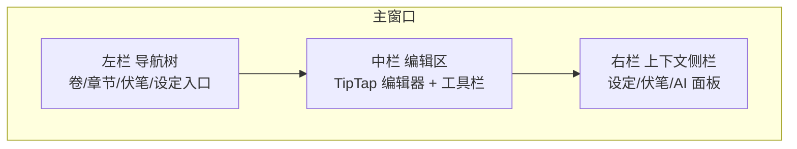
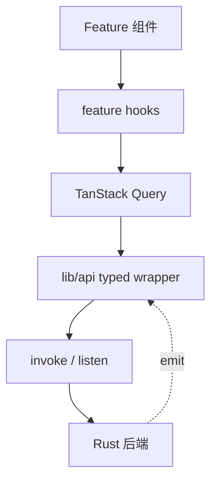

# Thread / 灰线 — 前端模块设计

> 本文承接 [01.tech-stack.md](01.tech-stack.md) 与 [04.ipc-api.md](04.ipc-api.md)，定义前端目录结构、界面布局、路由、状态管理与编辑器集成要点。

---

## 1. 目录结构

```text
src/
├── main.tsx                 # 入口
├── App.tsx                  # Provider + RouterProvider
├── app/
│   └── router.tsx           # TanStack Router 路由树
├── pages/                   # 路由页面（书架、写作、大纲…）
├── layout/                  # 壳层布局与 Provider
│   ├── project-layout.tsx   # 项目内导航壳
│   └── providers/
├── components/              # 业务组件 + ui/
│   ├── ai-panel.tsx
│   ├── foreshadow-side-panel.tsx
│   └── ui/                  # shadcn/ui
├── stores/                  # Zustand store
├── i18n/                    # 多语言
├── lib/
│   ├── api/                 # IPC typed wrapper（见 04.ipc-api.md）
│   ├── editor/              # TipTap 扩展与 Markdown 序列化
│   └── utils.ts
└── styles/
```

**约定**：页面进 `pages/`，路由壳进 `layout/`，跨页面复用的业务 UI 进 `components/`，基础组件进 `components/ui/`。

---

## 2. 界面布局

主界面采用经典写作工具的**三栏布局**：左侧导航树、中间编辑器、右侧设定侧栏。顶部为工具栏，底部为状态栏。



- **左栏（导航）**：项目切换、卷/章节树（可拖拽排序）、快捷入口（大纲、人物、世界观、时间线、伏笔、统计）。
- **中栏（编辑）**：TipTap 编辑器、格式工具栏、字数统计、保存状态指示、专注/沉浸模式切换。
- **右栏（上下文）**：可切换标签页 —— 当前章节相关设定、伏笔（未回收提醒）、AI 面板。可折叠。
- **底部状态栏**：字数、目标进度、保存状态、AI 状态。

侧栏可折叠以进入**沉浸式写作**（隐藏左右栏，仅留编辑区）。

---

## 3. 路由结构

使用 **TanStack Router**，单窗口内多视图：

```text
/                                   # 项目选择/新建（书架）
/project/$projectId                 # 进入某作品（默认重定向到 write）
/project/$projectId/write           # 写作视图（三栏，默认打开最近章节）
/project/$projectId/write/$chapterId
/project/$projectId/outline         # 大纲 / 剧情线
/project/$projectId/characters      # 人物 + 关系图
/project/$projectId/world           # 世界观（地点/势力/物品）
/project/$projectId/timeline        # 时间线
/project/$projectId/foreshadowing   # 伏笔总览
/project/$projectId/stats           # 统计
/project/$projectId/settings        # 设置（含 AI 配置、导出）
```

左栏导航在 `write` 视图内常驻；其余为全屏管理视图。

---

## 4. 状态管理（Zustand）

按关注点拆分多个小 store，避免单一巨型 store：

| Store | 职责 |
| --- | --- |
| `useProjectStore` | 当前项目、书架列表 |
| `useEditorStore` | 当前章节、草稿内容、保存状态（saving/saved/error）、脏标记 |
| `useUiStore` | 布局（侧栏折叠、沉浸模式）、主题、右栏当前标签 |
| `useAiStore` | AI 面板状态、流式缓冲、请求生命周期 |

- **服务端数据**（列表/详情）优先用 **TanStack Query** 缓存，Zustand 只存**纯 UI/交互状态**与编辑器草稿。
- 写操作成功后失效相关 query key（见 [04.ipc-api.md](04.ipc-api.md) §4）。

```ts
// stores/editorStore.ts（示意）
import { create } from "zustand";

type SaveState = "idle" | "saving" | "saved" | "error";

interface EditorState {
  chapterId: string | null;
  draft: string;            // 当前 Markdown 草稿
  dirty: boolean;
  saveState: SaveState;
  setDraft: (md: string) => void;
  markSaved: () => void;
}

export const useEditorStore = create<EditorState>((set) => ({
  chapterId: null,
  draft: "",
  dirty: false,
  saveState: "idle",
  setDraft: (md) => set({ draft: md, dirty: true }),
  markSaved: () => set({ dirty: false, saveState: "saved" }),
}));
```

---

## 5. 编辑器集成（TipTap + Markdown）

### 5.1 扩展配置

```ts
// lib/editor/index.ts（示意）
import { useEditor } from "@tiptap/react";
import StarterKit from "@tiptap/starter-kit";
import { Markdown } from "tiptap-markdown";
import CharacterCount from "@tiptap/extension-character-count";

export function useNovelEditor(initialMarkdown: string) {
  return useEditor({
    extensions: [
      StarterKit,
      Markdown,          // Markdown 双向转换
      CharacterCount,    // 字数统计
    ],
    content: initialMarkdown, // 以 Markdown 初始化
  });
}
```

### 5.2 读写 Markdown

```ts
// 读取（保存时）
const markdown = editor.storage.markdown.getMarkdown();

// 写入（切换章节时）
editor.commands.setContent(chapter.content); // content 为 Markdown 字符串
```

### 5.3 autosave 接入

- 监听编辑器 `onUpdate` → 写入 `useEditorStore.setDraft` → 防抖 800ms 后调用 `chapterSave`（见 [02.architecture.md](02.architecture.md) §3.1）。
- 切章节 / 窗口失焦 / 关闭前强制 flush 保存，避免丢字。
- 保存状态由 `chapter://saved` 事件或调用返回更新，底部状态栏展示。

### 5.4 字数统计

- 使用 `@tiptap/extension-character-count` 实时取字数，中文按字符计。
- 保存时后端重新计算 `word_count` 落库并回传，作为权威值。

---

## 6. shadcn/ui 使用约定

- 组件通过 CLI 生成到 `src/components/ui`，可直接改源码，不做二次 npm 封装。
- 业务组件放 `components/`，基础组件放 `components/ui`，页面放 `pages/`。
- 主题（明/暗）通过 Tailwind `dark` class 与 CSS 变量控制，集中在 `styles/globals.css`。
- 图标统一用 `lucide-react`。

---

## 7. 与后端交互小结



- 组件 → hooks → Query → api wrapper → IPC，单向清晰。
- 事件（autosave/AI/导出进度）经 api 层订阅后写入对应 store。
